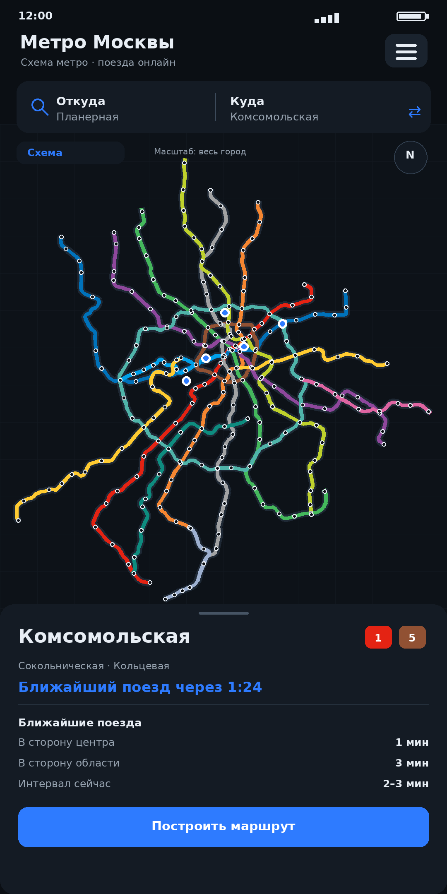
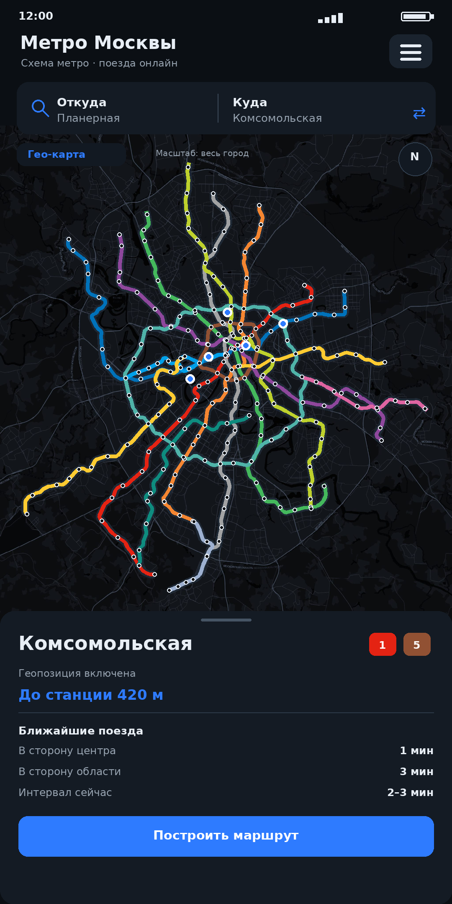
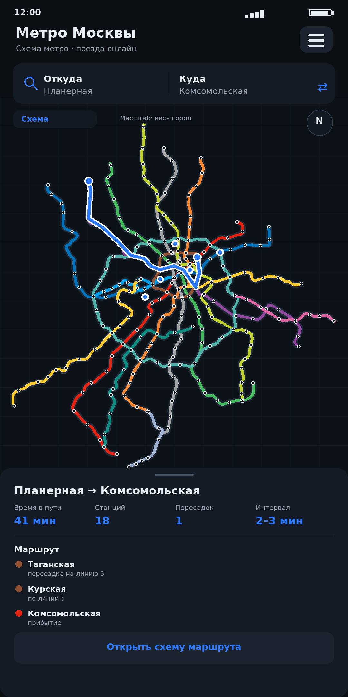
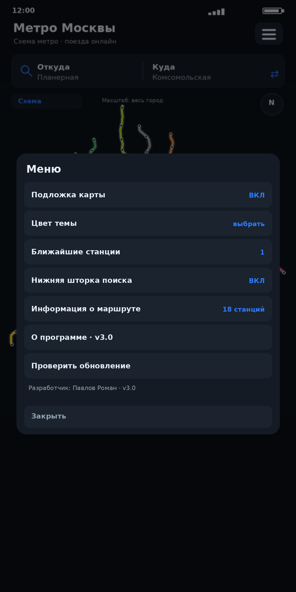
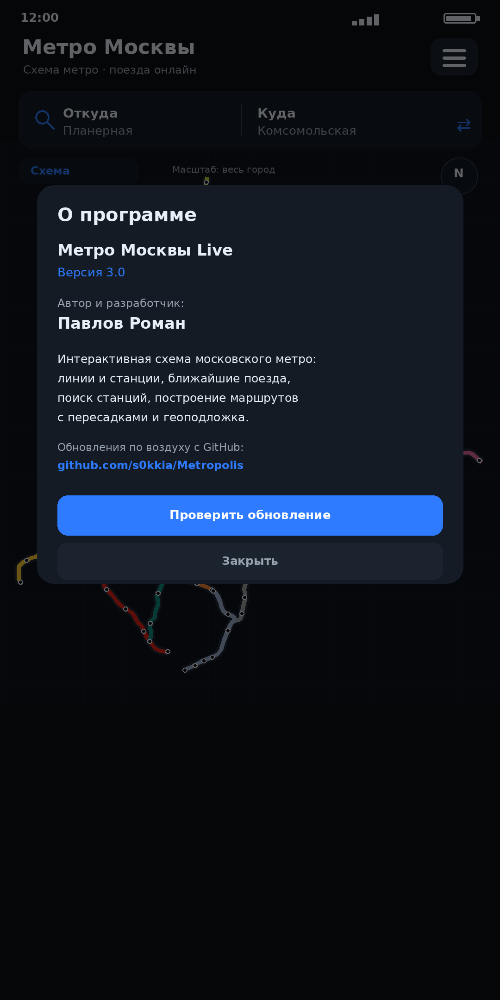

# Метро Москвы Live

**Метро Москвы Live** — Android-приложение с интерактивной схемой московского метро, онлайн-поездами и построением маршрутов. Работает на телефонах и планшетах, поддерживает тёмную тему, геоподложку и обновления «по воздуху» прямо с GitHub.

**Автор и разработчик: Павлов Роман** ([@s0kkia](https://github.com/s0kkia))

---

## Скриншоты

<p align="center">
  
  
  
</p>

<p align="center">
  
  
</p>

---

## Возможности

- Интерактивная схема всех линий и станций московского метро
- Переключение между схемой и настоящей геоподложкой Москвы
- Положение поездов и расчёт времени прибытия ближайших поездов
- Поиск станций и карточка станции с ближайшими поездами
- Построение маршрутов с автоматическим поиском пересадок
- Время в пути, количество станций и пересадок
- Тёмная тема и выбор акцентного цвета
- Работа без рекламы и без платных API-ключей
- **Обновления по воздуху с GitHub** — проверка при запуске и в меню

---

## Установка

1. Скачайте APK со страницы [Releases](../../releases/latest).
2. Разрешите установку приложений из неизвестных источников.
3. Установите приложение.

> **Важно:** версия **3.0** подписана новым ключом. Если у вас установлена версия **2.9 или раньше**, сначала удалите её, затем установите 3.0. Все последующие обновления (3.0 → 3.x) будут ставиться поверх без удаления.

---

## Обновления по воздуху (OTA)

Приложение проверяет обновления через файл [`version.json`](version.json) в ветке `main`:

1. При запуске приложение автоматически сравнивает `versionCode` с серверным.
2. Если доступна новая версия, появляется диалог с кнопкой **«Обновить сейчас»**.
3. APK скачивается через системный менеджер загрузок и сразу открывается установщик — остаётся только подтвердить установку.
4. Проверку также можно запустить вручную: **Меню → Проверить обновление**.
5. Информация об авторе и версии: **Меню → О программе**.

Формат `version.json`:

```json
{
  "versionName": "3.0",
  "versionCode": 30,
  "url": "https://github.com/s0kkia/Metropolis/releases/download/v3.0/MoscowMetro-3.0.apk",
  "changelog": "Что нового..."
}
```

---

## Что нового в 3.0

- Указан автор приложения — **Павлов Роман**
- Добавлен раздел **«О программе»** с версией и автором
- Добавлена автоматическая проверка обновлений при запуске
- Добавлена кнопка **«Проверить обновление»** в меню
- Обновление по воздуху с GitHub в один тап
- Версия приложения поднята до **3.0** (`versionCode 30`)

---

## Технические детали

- Пакет: `ru.metromsk.live`
- Минимальная версия Android: 13 (API 33)
- Целевая версия: Android 14 (API 34)
- Разрешения: интернет, состояние сети, геолокация, установка обновлений
- Подпись: все версии начиная с 3.0 подписываются одним ключом

В репозитории также сохранён исходный проект ранней версии приложения (`app/`) и старая сборка — они оставлены для истории.
